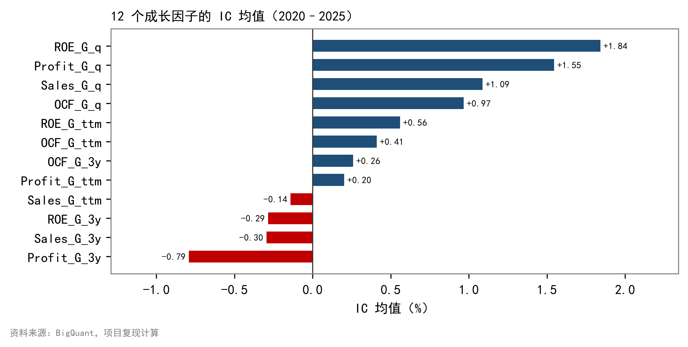
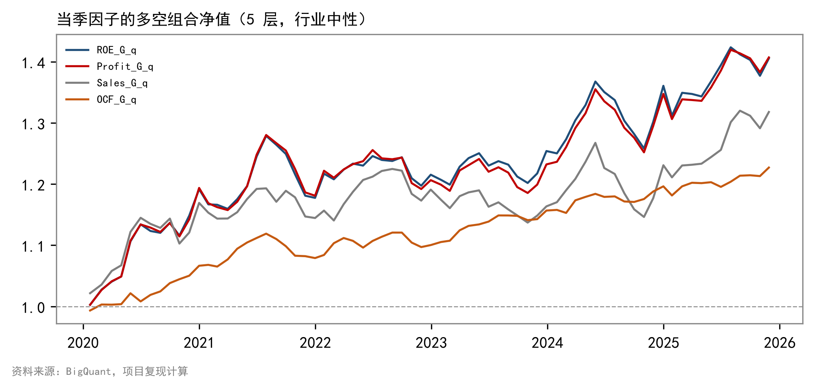
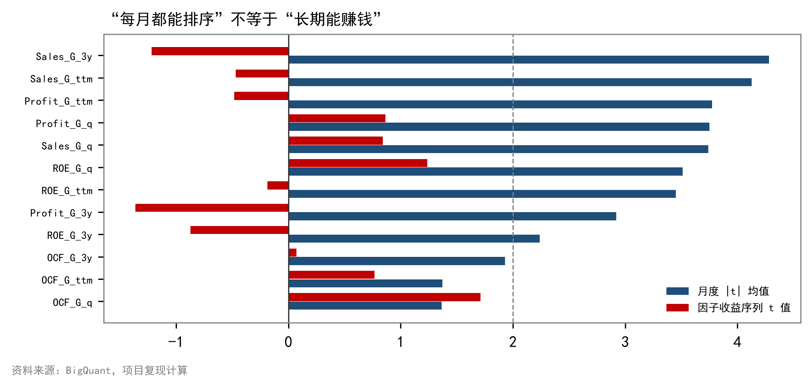
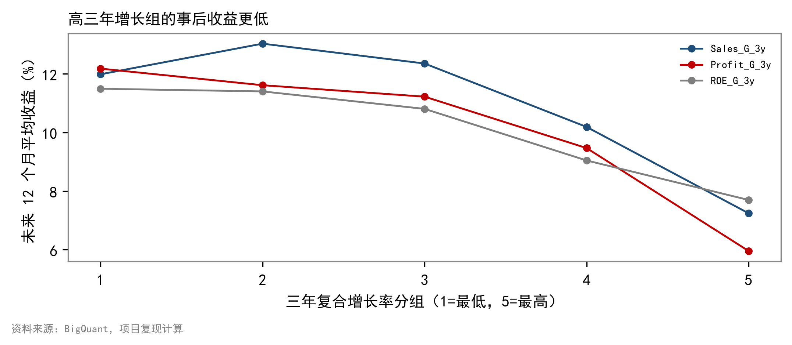

# 量化研报复现：成长因子单因子测试（A 股 2020–2025）


复现华泰证券《单因子测试之成长类因子》（2016）的完整研究框架，并在 **2020–2025 年 A 股样本**上独立检验 12 个成长因子。
项目包含数据管道、因子构建、IC / 分层 / 回归 / 稳健性检验、25 页研报、汇报材料、BigQuant Notebook 与平台单文件脚本。

> **研究定位**：复现的是"方法"，不是"结论"。原文结论只作为待检验假设，结果开放。

---

## 核心结论

| 结论 | 关键证据 |
|---|---|
| 当季（q）因子仍能排序 | ROE_G_q 的 IC 1.84%、五层单调性 0.9；Profit_G_q 1.55%、单调性 1.0 |
| 但强度明显衰减 | 原文 IC 约 2%、多空 6%、收益 t 值 2.6–3.5；本文 IC 1.0%–1.8%、多空 2.5%–5.9%、收益 t 0.8–1.7 |
| 三年复合因子反向 | Profit_G_3y 的 IC -0.79%，最高增长组事后 12 个月收益比最低组低约 5–6 个百分点 |
| 因子高度依赖年景 | 2020 年 ROE_G_q 的 IC +4.53%、2024 年 +3.74%；2021 年 -0.20%、2023 年 +1.04% |
| 扣费后仍有微弱 alpha | 真实换手 8%–24%，扣双边千三后当季多空 2.6%–5.3%，但信息比率仅 0.35–0.54 |
| 多重检验后仅一个显著 | BH-FDR 校正后只有 `OCF_G_q` 通过 5%（p_adj = 0.0009） |

---

## 目录

- [1. 研究设计](#1-研究设计)
- [2. 数据](#2-数据)
- [3. 因子构建](#3-因子构建)
- [4. 测试方法](#4-测试方法)
- [5. 结果](#5-结果)
- [6. 经济含义](#6-经济含义)
- [7. 与原文的对话](#7-与原文的对话)
- [8. 项目结构](#8-项目结构)
- [9. 快速开始](#9-快速开始)
- [10. 复现一致性](#10-复现一致性)
- [11. 局限与风险提示](#11-局限与风险提示)
- [12. 文档与引用](#12-文档与引用)

---

## 1. 研究设计

### 1.1 三个问题

1. 成长因子在 2020–2025 年是否仍有横截面区分度？
2. 这种区分度能否转化为扣除成本后的收益？
3. 与 2016 年原文的差异，来自样本期、市场状态，还是因子本身失效？

### 1.2 与原文的口径差异

| 维度 | 原文（2016） | 本文（2020–2025） | 说明 |
|---|---|---|---|
| 样本期 | 2005-04 ~ 2016-08 | 2020-01 ~ 2025-12 | 样本外独立检验 |
| 当季口径 | Wind 最新财报同比 | 单季（`_mrq`）同比 | 更贴合"当季"字面 |
| 基准 | 沪深 300 | 全 A 流通市值加权 | 降级口径，已披露 |
| 行业权重 | 沪深 300 行业权重 | 全 A 流通市值行业占比 | 降级口径，已披露 |
| 估值对比 | 有 | 不做 | 聚焦成长因子本身 |
| 行业分类 | 申万（当年） | 申万 2021（回溯） | 存在分类漂移 |

---

## 2. 数据

### 2.1 来源

- 行情与财务：BigQuant `cn_stock_prefactors`（日频 PIT 宽表，6,937 列）
- 指数：`cn_stock_index_bar1d`（沪深 300、中证 500、中证 1000）
- 导出脚本：`export/bigquant_export_v41.py`，按年拉取并压成月末

### 2.2 样本漏斗

| 步骤 | 行数 | 股票数 |
|---|---|---|
| 原始月频面板 | 519,860 | 5,947 |
| 剔除北交所 / ST / 停牌 / 次新 | 445,724 | 5,317 |
| 再剔除"截面期次日停牌" | 445,383 | 5,317 |
| 评估期截面 | 72 个月 | — |

### 2.3 数据质量

| 检查 | 结果 |
|---|---|
| 主键重复 | 0 |
| 财务 PIT | 变动日 = 公告日（平安银行 03-10 / 04-21 / 10-21） |
| 退市股 | 乐视退、暴风退、退市锐电 3/3 在库，无生存偏差 |
| 复权 | `close` 已是后复权；平安银行 2024 年 +35.4% 与真实一致 |
| 行业覆盖 | 2017 年 99.9%，2025 年 95.7% |

**已处理的数据问题**：北交所 2025-10 断档、涨跌停状态误读、财务 0 填充、负营收、
次新股极端收益、停牌缺价。详见 [docs/data_guide.md](docs/data_guide.md)。

---

## 3. 因子构建

### 3.1 十二个因子

| 科目 | 单季同比（q） | TTM 同比 | 三年复合（3Y） |
|---|---|---|---|
| 营业收入 | `Sales_G_q` | `Sales_G_ttm` | `Sales_G_3y` |
| 归母净利润 | `Profit_G_q` | `Profit_G_ttm` | `Profit_G_3y` |
| 经营现金流 | `OCF_G_q` | `OCF_G_ttm` | `OCF_G_3y` |
| ROE | `ROE_G_q` | `ROE_G_ttm` | `ROE_G_3y` |

### 3.2 公式

同比（分母取绝对值，避免亏损转盈时符号翻转）：

```
G = (X_t - X_{t-12}) / |X_{t-12}|
```

三年复合（要求两端同为正）：

```
G_3y = (X_t / X_{t-36})^(1/3) - 1
```

ROE 定义为 `净利润 / 归母净资产`，再按上述口径取同比或三年复合。

### 3.3 数据清洗

| 规则 | 处理 |
|---|---|
| 平台用 0 填充的缺失 | 营收 ≤0、利润/现金流 =0、净资产 ≤0 一律视为缺失 |
| 负营收（重组/追溯调整） | 视为缺失 |
| 增长率基期为 0 或负 | 同比用绝对值分母；三年复合记缺失 |
| 股票池 | 剔除北交所、ST、停牌、上市不足 12 个月、次日停牌 |

### 3.4 预处理

每个截面依次执行：

1. 中位数 ±5×MAD 去极值
2. 对行业哑变量 + ln(流通市值) 回归取残差（IC 与分层用）
3. z-score 标准化

---

## 4. 测试方法

| 方法 | 设定 | 评价指标 |
|---|---|---|
| **IC 分析** | 因子残差与下月收益的 Spearman 相关 | IC 均值、t 值、IR、IC>0 占比 |
| **分层回测** | 行业内分 5 层、层内等权，多空 = 第 1 层 − 第 5 层 | 年化、夏普、回撤、单调性 |
| **回归法** | WLS，权重 √流通市值，含行业哑变量 | \|t\| 均值、因子收益率、收益序列 t |
| **IC 衰减** | 持有期 1–6 个月 | IC 随期限变化 |
| **稳健性** | 分年度、分市值、分行业、真实换手成本 | 分组 IC、扣费后收益 |
| **多重检验** | Benjamini–Hochberg FDR | p_adj |

**交易成本**：按真实持仓重叠度计算月换手，双边千三。

---

## 5. 结果

### 5.1 IC 分析

| 因子 | IC 均值 | t 值 | FDR p_adj | 5% 显著 |
|---|---|---|---|---|
| ROE_G_q | +1.84% | 2.46 | 0.084 | 否 |
| Profit_G_q | +1.55% | 2.05 | 0.163 | 否 |
| Sales_G_q | +1.09% | 1.49 | 0.327 | 否 |
| OCF_G_q | +0.97% | **3.96** | **0.0009** | **是** |
| ROE_G_ttm | +0.56% | 0.81 | 0.712 | 否 |
| OCF_G_ttm | +0.41% | 1.49 | 0.327 | 否 |
| OCF_G_3y | +0.26% | 0.60 | 0.823 | 否 |
| Profit_G_ttm | +0.20% | 0.30 | 0.831 | 否 |
| Sales_G_ttm | -0.14% | -0.17 | 0.863 | 否 |
| ROE_G_3y | -0.29% | -0.41 | 0.831 | 否 |
| Sales_G_3y | -0.30% | -0.39 | 0.831 | 否 |
| Profit_G_3y | -0.79% | -1.11 | 0.537 | 否 |



### 5.2 分层回测

| 因子 | TOP 年化 | 多空毛收益 | 扣费后 | 多空夏普 | 最大回撤 | 单调性 |
|---|---|---|---|---|---|---|
| ROE_G_q | 17.1% | +5.9% | +5.2% | 0.88 | -8.0% | +0.9 |
| Profit_G_q | 16.8% | +5.9% | +5.2% | 0.88 | -7.8% | +1.0 |
| Sales_G_q | 16.3% | +4.8% | +4.1% | 0.77 | -9.6% | +1.0 |
| OCF_G_q | 15.4% | +3.5% | +2.6% | 1.28 | -3.6% | +1.0 |
| Profit_G_3y | 11.2% | -2.6% | -3.0% | -0.45 | -25.8% | -0.7 |
| Sales_G_3y | 12.6% | -0.9% | -1.2% | -0.10 | -19.2% | -0.3 |



### 5.3 回归法

| 因子 | \|t\| 均值 | \|t\|>2 占比 | 因子收益率均值 | 收益序列 t |
|---|---|---|---|---|
| ROE_G_q | 3.52 | 67.6% | +0.12% | +1.25 |
| Profit_G_q | 3.76 | 80.3% | +0.09% | +0.87 |
| Sales_G_q | 3.74 | 76.1% | +0.09% | +0.84 |
| OCF_G_q | 1.37 | 22.5% | +0.07% | **+1.73** |
| Profit_G_3y | 2.92 | 60.6% | -0.14% | -1.37 |

> **关键矛盾**：月度 \|t\| 均值 3.5–4.3，但收益序列 t 只有 0.8–1.7。

### 5.4 IC 衰减与分年度

- 当季因子 IC 到 6 个月几乎不衰减（ROE_G_q 1.86% → 1.88%），与原文"市场消化快"的解释相反；
- 三年复合因子的负 IC 随时间加深（Profit_G_3y 从 -0.79% 到 -3.95%）；
- 分年度：2020 与 2024 强，2021 与 2023 弱。

### 5.5 成本与稳健性

| 因子 | 月换手 | 多空毛 | 扣费后 | 夏普（毛→净） |
|---|---|---|---|---|
| ROE_G_q | 20.4% | +5.9% | +5.2% | 0.88 → 0.77 |
| Profit_G_q | 20.3% | +5.9% | +5.2% | 0.88 → 0.78 |
| Sales_G_q | 18.2% | +4.8% | +4.1% | 0.77 → 0.67 |
| OCF_G_q | 24.4% | +3.5% | +2.6% | 1.28 → 0.96 |

- 填 0 vs 剔除缺失：IC 差异 ≤0.31%，结论不敏感；
- 分市值：小盘更有效（ROE_G_q 小盘 IC 2.94%、大盘 1.13%）；
- 分行业：ROE_G_q 在 27/31 个行业为正，银行 -3.26% 是唯一显著为负。

### 5.6 两个深挖结论

**（1）为什么 |t| 高但收益 t 低？**

| 指标 | 数值 |
|---|---|
| 12 因子月度 \|t\| 均值 | 3.04 |
| 12 因子收益序列 t 均值 | 0.07 |
| 横截面相关（\|t\| vs 收益 t） | **-0.35** |
| 月度 β 符号翻转率 | 47% |

4,000 只股票的截面上，几乎任何因子每月都能显著；但 β 有近一半月份翻符号，长期均值自然不显著。
**高 |t| 反而对应低稳定性。**



**（2）为什么三年复合因子反向？**

- 动量暴露：3Y 因子与过去 12 个月收益正相关（0.02–0.15）；
- 分组反转：高动量组 3Y 的 IC 为 +1.0%～+1.4%，低动量组为 -0.9%～-3.1%；
- 事后收益：Sales_G_3y 五分组未来 12 个月收益从 12.0% 降到 7.2%，Profit_G_3y 从 12.2% 降到 6.0%。



---

## 6. 经济含义

### 6.1 当季因子为什么仍有效

当季同比只使用最近一个季度的信息，对边际变化最敏感。只要市场对短期盈利改善仍存在反应不足，
当季因子就能提供区分度。本文的 IC 与分层单调性都支持这一点。

### 6.2 三年复合为什么反向

三年复合同时承载两种属性：**长期成长**与**过去赢家**。

- 长期成长在 2020–2025 年被估值压缩，"高增长"往往意味着"高估值"；
- 过去赢家在 2021 年后的动量反转中受损；
- 在低动量组里，高增长又常意味着基本面与股价背离，形成"落刀型"股票。

三者叠加，导致无条件做多高 3Y 增长反而跑输。

### 6.3 为什么"分年景"

2020 年是疫后成长行情、2024 年是反弹年，成长因子表现突出；
2021 年杀估值、2023 年小微盘与主题行情，成长因子被压制。
全样本平均会把这两种状态抵消，造成"因子失效"的错觉。

### 6.4 对组合构建的启示

1. 优先使用当季因子，尤其是 ROE_G_q 与 Profit_G_q；
2. `OCF_G_q` 作为稳健型选择：统计上最显著、夏普最高、回撤最小；
3. 不要同时使用 ROE 与 Profit（相关性 0.975），存在严重共线；
4. 不要无条件做多高三年增长，尤其在低动量与大盘股中；
5. 把因子有效性放在市场状态框架下评估，而非看全样本平均。

---

## 7. 与原文的对话

| 原文结论 | 本文判断 | 依据 |
|---|---|---|
| 当季 > TTM > 三年 | **支持，且更极端** | q 因子 IC 为正，3Y 为负 |
| Profit/ROE > Sales > OCF | 部分支持 | ROE/Profit 分层最强，OCF 统计最稳 |
| 因子收益率显著（t 2.6–3.5） | **不支持** | 收益序列 t 仅 0.84–1.73 |
| 市场消化快、当季最优 | **不支持** | IC 到 6 个月不衰减 |
| 3Y 因子基本无效 | 不一致 | 3Y 因子系统性反向 |

**差异来源**：样本期（注册制、机构化）、市场状态（2021 杀估值）、口径（单季、次日停牌）、成本。

---

## 8. 项目结构

```
quant-growth-factor/
├─ bq_export_v41/                数据（50 MB，不纳入 git）
│   ├─ panel_2016.csv … panel_2025.csv
│   ├─ index_000300/905/852_monthly.csv
│   ├─ suspension_events.csv  limit_events_valid.csv
│   └─ daily_fin_sample.csv
├─ src/                          核心代码
│   ├─ config.py                 路径、股票池规则、因子清单
│   ├─ data.py                   加载、过滤、次日停牌、宽表
│   ├─ factors.py                12 因子 + 数据清洗
│   ├─ preprocess.py             去极值、行业中性、标准化
│   └─ evaluate.py               前瞻收益、IC、分层、绩效
├─ scripts/                      分析脚本
│   ├─ build_factor_panel.py     P1 因子面板 + IC + 5 层
│   ├─ full_sample_tests.py      P2 回归 / 衰减 / 10 层 / 分组
│   ├─ p3_robustness.py          P3 超额 / 换手 / FDR / 分段
│   ├─ p4_deepdive.py            深挖：|t| 与 3Y
│   ├─ make_figures*.py          图表
│   ├─ build_report.py           25 页 Word
│   └─ build_ppt.py              14 页汇报
├─ platform/                     平台复现
│   ├─ bq_factor_lab.py          单文件流水线（local / dai）
│   └─ sync.sh                   平台同步（git / tarball）
├─ notebook/成长因子测试.ipynb     BigQuant Notebook（31 单元）
├─ tests/                        15 个测试
├─ docs/                         文档与阶段报告
├─ report/                       研报、PPT、图表
└─ output/                       结果表（可再生）
```

---

## 9. 快速开始

### 9.1 环境

- Python 3.12（项目自带 `.pylibs`，用 `env.cmd` 调用）
- 依赖：pandas、numpy、scipy、statsmodels、matplotlib、python-docx、python-pptx

```powershell
& '.\env.cmd' -m pytest tests -q          # 15 passed
& '.\env.cmd' scripts\build_factor_panel.py
& '.\env.cmd' scripts\full_sample_tests.py
```

### 9.2 BigQuant Notebook

打开 `notebook/成长因子测试.ipynb`，**Run All** 即可：

- 优先读取 `/bq_export_v41/`，不存在自动改 `dai` 查询；
- 自带结果自检（12 项 PASS/FAIL）；
- 末尾读取全部 CSV/PNG 并可视化，打包 `out_notebook.zip`。

### 9.3 平台单文件脚本

```bash
python platform/bq_factor_lab.py \
  --source local --data-dir /bq_export_v41 --out-dir ./out
```

与本地结果**逐格一致（max diff = 0）**。

### 9.4 重新生成报告

```powershell
& '.\env.cmd' scripts\make_figures.py
& '.\env.cmd' scripts\make_figures2.py
& '.\env.cmd' scripts\make_figures3.py
& '.\env.cmd' scripts\build_report.py
& '.\env.cmd' scripts\build_ppt.py
```

---

## 10. 复现一致性

| 验证 | 方法 | 结果 |
|---|---|---|
| 单元/冒烟测试 | `pytest tests -q` | **15 passed** |
| 无前视偏差 | 截断未来数据后重算因子，逐格比对 | 完全一致（1e-10） |
| 平台 vs 本地 | 同一数据跑两套代码 | IC 最大差 **0** |
| Notebook 自检 | 12 个因子 IC 与基准值比对 | **12/12 PASS** |

---

## 11. 局限与风险提示

1. 样本期仅 6 年，经历的市场状态有限；
2. 基准与行业权重为全 A 流通市值口径，与原文沪深 300 不同；
3. 未取得估值因子（PB/PE），无法检验"高增长是否因高估值而反向"；
4. 成本按固定双边千三估算，未建模冲击成本与涨跌停无法成交；
5. 行业分类为申万 2021 回溯，存在分类漂移；
6. 单因子结论不能直接推广到多因子组合。

> 本报告为方法复现与研究练习，不构成投资建议。历史规律存在失效风险。

---

## 12. 文档与引用

| 文档 | 内容 |
|---|---|
| [GUIDE.md](GUIDE.md) | 执行指南：流程、规范、回滚、汇报 |
| [docs/data_guide.md](docs/data_guide.md) | 数据来源、字段字典、存储结构 |
| [docs/reports/P1_factor_panel.md](docs/reports/P1_factor_panel.md) | 因子面板、IC、5 层 |
| [docs/reports/P2_full_sample.md](docs/reports/P2_full_sample.md) | 回归、衰减、10 层、分组 |
| [docs/reports/P3_robustness.md](docs/reports/P3_robustness.md) | 超额、换手、FDR、填 0 |
| [docs/reports/P4_report_writing.md](docs/reports/P4_report_writing.md) | 研报结构与深挖结论 |
| [docs/reports/汇报讲稿_20分钟.md](docs/reports/汇报讲稿_20分钟.md) | 20 分钟课堂讲稿 + 18 个评委问答 |
| [report/成长因子复现报告.pdf](report/成长因子复现报告.pdf) | 25 页完整研报 |
| [report/成长因子复现汇报.pdf](report/成长因子复现汇报.pdf) | 14 页汇报材料 |

**原始报告**：华泰证券，《华泰单因子测试之成长类因子》（华泰多因子系列之三），2016-10-31。

**数据平台**：BigQuant（`cn_stock_prefactors`、`cn_stock_index_bar1d`）。
